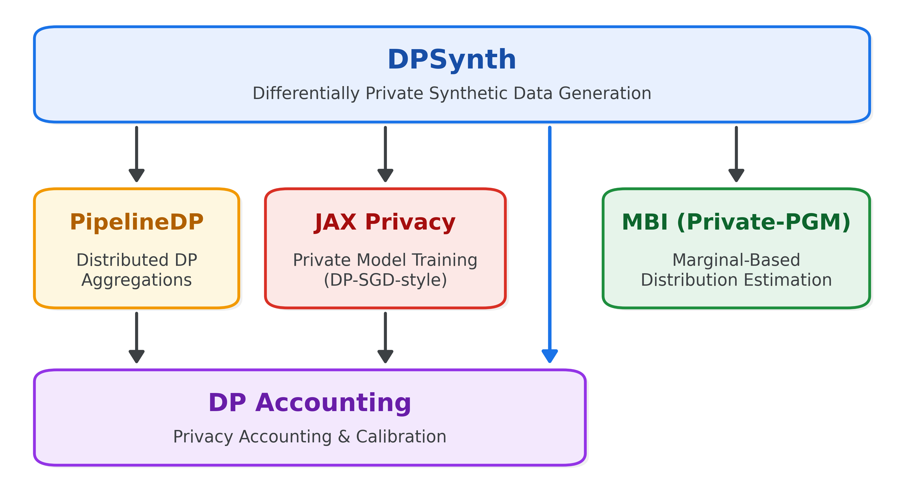

<!-- Copyright 2026 Google LLC

Licensed under the Apache License, Version 2.0 (the "License");
you may not use this file except in compliance with the License.
You may obtain a copy of the License at

    http://www.apache.org/licenses/LICENSE-2.0

Unless required by applicable law or agreed to in writing, software
distributed under the License is distributed on an "AS IS" BASIS,
WITHOUT WARRANTIES OR CONDITIONS OF ANY KIND, either express or implied.
See the License for the specific language governing permissions and
limitations under the License. -->

# The DPSynth Library Ecosystem

<!-- disableFinding(LINK_RELATIVE_G3DOC) -->

Generating differentially private synthetic data requires solving several
distinct technical problems: tracking formal privacy guarantees across composed
operations, fitting statistical models to noisy measurements, training neural
networks with private gradients, and scaling data aggregations across
distributed datasets. Rather than reimplementing all of these layers in a single
monolith, [DPSynth](https://github.com/google/dpsynth) acts as the unifying
synthesis layer on top of four specialized open-source libraries. These
libraries are actively co-developed and co-evolving, with new capabilities in
each library regularly driven by the requirements of the others.

## Role of Each Library

**[DPSynth](https://github.com/google/dpsynth).** At the top of the stack,
DPSynth is the primary library that implements complete, end-to-end
differentially private mechanisms for synthetic data generation. It combines the
specialized libraries below into unified synthesis workflows and surfaces an
easy-to-use API that solves a general problem in differential privacy,
abstracting away the distinct APIs and low-level complexities of working
directly with each underlying library.

**[DP Accounting](https://github.com/google/differential-privacy/tree/main/python/dp_accounting).**
At the foundation of the stack, DP Accounting provides the mathematical language
for expressing and composing differential privacy guarantees across DPSynth, JAX
Privacy, and PipelineDP. It does not implement mechanisms that run on data and
is completely agnostic to datasets or models. Instead, mechanisms in
higher-level libraries describe their privacy footprint using `DpEvent` objects.
Before a mechanism ever touches sensitive data, DPSynth uses DP Accounting to
calibrate noise scales so that the composed workflow meets a target privacy
budget, and afterward uses it to produce privacy reports containing
$(\epsilon, \delta)$ curves, Gaussian DP estimates, and hypothesis-testing
trade-off curves.

**[MBI (Private-PGM)](https://github.com/ryan112358/mbi).** MBI solves the
problem of estimating discrete distributions from noisy measurements of their
marginals using
[a variety of estimation methods](https://differentialprivacy.org/synth-data-1/).
It operates over discrete data cubes represented as NumPy or JAX tensors and
provides a general solution to the distribution estimation step of
marginal-based synthetic data mechanisms. Crucially, MBI is pure
post-processing: it does not add noise or implement end-to-end privacy
mechanisms, allowing it to focus entirely on fast, JAX-accelerated mathematical
optimization.

**[JAX Privacy](https://github.com/google-deepmind/jax_privacy).** While
marginal-based mechanisms work well for tabular and discrete data, other
modalities and domains call for neural approaches. JAX Privacy provides the
toolkit for training arbitrary machine learning models with DP-SGD-style
mechanisms. DPSynth uses JAX Privacy in several ways, including
transformer-based approaches for tabular and sequence data as well as LLM
fine-tuning approaches for free-form text. More generally, through
`dpsynth.DPTrainer`, DPSynth can use JAX Privacy to generate synthetic data for
any modality as long as there is a generative model and compatible dataset for
that modality.

**[PipelineDP](https://github.com/OpenMined/pipeline-dp).** Finally, for
large-scale datasets that do not fit in single-machine memory, DPSynth
integrates with PipelineDP to scale computations across distributed execution
backends such as Apache Beam and Apache Spark. PipelineDP implements distributed
DP primitives (including private counts, sums, quantiles, contribution bounding,
and partition selection), while leaving the design of higher-level, end-to-end
synthesis mechanisms to DPSynth.
