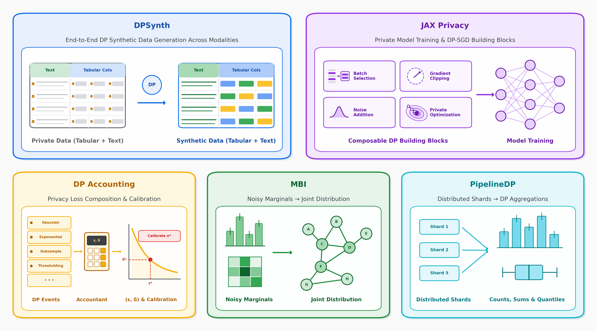
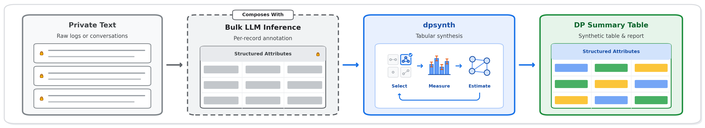
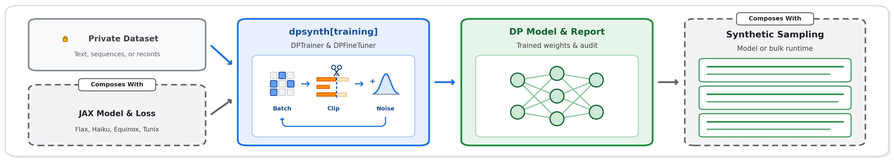
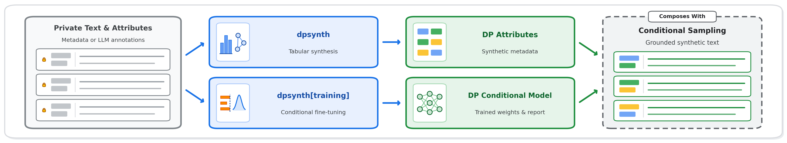

<!-- Copyright 2026 Google LLC

Licensed under the Apache License, Version 2.0 (the "License");
you may not use this file except in compliance with the License.
You may obtain a copy of the License at

    http://www.apache.org/licenses/LICENSE-2.0

Unless required by applicable law or agreed to in writing, software
distributed under the License is distributed on an "AS IS" BASIS,
WITHOUT WARRANTIES OR CONDITIONS OF ANY KIND, either express or implied.
See the License for the specific language governing permissions and
limitations under the License. -->

# The DPSynth Ecosystem

<!-- disableFinding(LINK_RELATIVE_G3DOC) -->

Generating differentially private synthetic data requires solving several
distinct technical problems: tracking formal privacy guarantees across composed
operations, fitting statistical models to noisy measurements, training machine
learning models with DP-SGD-style mechanisms, and solving large-scale systems
challenges. Rather than reimplementing all of these layers in a single monolith,
[DPSynth](https://github.com/google-parfait/dpsynth) acts as the unifying
synthesis layer on top of four specialized open-source privacy libraries, while
composing naturally both across its own primitives and with external tools for
bulk model inference, custom model definition, and data processing.

## What DPSynth Depends On

DP Accounting and MBI are core dependencies installed by default, while JAX
Privacy and PipelineDP are opt-in dependencies installed via
`dpsynth[training]` and `dpsynth[pipeline]` only when needed. These libraries
are actively co-developed, with new features across the lower-level libraries
regularly driven by the requirements of DPSynth.

**[DPSynth](https://github.com/google-parfait/dpsynth).** At the top of the
stack, DPSynth is the primary library that implements complete, end-to-end
differentially private mechanisms for synthetic data generation. It combines the
specialized libraries below into unified synthesis workflows and surfaces an
easy-to-use API that solves a general problem in differential privacy,
abstracting away the low-level APIs and complexities of working directly with
each underlying library.

**[DP Accounting](https://github.com/google/differential-privacy/tree/main/python/dp_accounting).**
At the foundation of the stack, DP Accounting provides the mathematical language
for expressing and composing differential privacy guarantees across DPSynth, JAX
Privacy, and PipelineDP. It does not implement mechanisms that run on data and
is completely agnostic to datasets or models. Instead, mechanisms in
higher-level libraries describe their privacy footprint using `DpEvent` objects.
Before a mechanism ever touches sensitive data, DPSynth uses DP Accounting to
calibrate noise scales so that the composed workflow meets a target privacy
budget, and afterward uses it to produce privacy reports.

**[MBI](https://github.com/ryan112358/mbi).** MBI solves the problem of
estimating discrete distributions from noisy measurements of their marginals
using
[a variety of estimation methods](https://differentialprivacy.org/synth-data-1/).
It operates over discrete data cubes represented as NumPy or JAX tensors and
provides a general solution to the distribution estimation step of
marginal-based synthetic data mechanisms. Crucially, MBI is pure
post-processing: it does not add noise or implement end-to-end privacy
mechanisms, allowing it to focus entirely on fast, JAX-accelerated mathematical
optimization.

**[JAX Privacy](https://github.com/google-parfait/jax_privacy).** While
marginal-based mechanisms work well for tabular and discrete data, other
modalities and domains call for more flexible approaches. Installed as an opt-in
dependency via `dpsynth[training]` when needed, JAX Privacy provides the toolkit
for training arbitrary machine learning models with DP-SGD-style mechanisms.
DPSynth uses JAX Privacy in several ways, including transformer-based approaches
for tabular and sequence data as well as LLM fine-tuning approaches for
free-form text. More generally, through DPTrainer, DPSynth can use JAX Privacy
to generate synthetic data for any modality as long as there is a generative
model and compatible dataset for that modality.

**[PipelineDP](https://github.com/OpenMined/pipeline-dp).** Finally, for
large-scale datasets that do not fit in single-machine memory, DPSynth
integrates with PipelineDP, an external open-source library from OpenMined
installed via the opt-in `dpsynth[pipeline]` extra, to scale computations across
distributed execution backends such as Apache Beam and Apache Spark. PipelineDP
implements distributed DP primitives, while leaving the design of higher-level,
end-to-end synthesis mechanisms to DPSynth.

## What DPSynth Composes With

DPSynth keeps its dependency footprint focused on core differential privacy
primitives. Because every mechanism shares a uniform configuration, calibration,
and accounting contract, DPSynth composes cleanly both internally across its own
abstractions and externally with tools in the Python and JAX ecosystem.

**Self-Composition.** Methods for richer modalities in DPSynth are built by
composing simpler mechanisms rather than reimplementing privacy logic from
scratch. Mechanisms for relational and nested data compose directly on top of
DPSynth's tabular primitives, decomposing multi-table schemas and hierarchies
into coordinated tabular synthesis steps under a single privacy guarantee.
Likewise, methods for free-form text and other complex modalities compose
naturally through the DPTrainer abstraction in `dpsynth[training]`, either on
its own or paired with tabular primitives.

**Bulk Inference.** Although DPSynth does not depend on bulk LLM inference
libraries, the two compose remarkably well across two distinct use cases. First,
for extracting structured insights from sensitive unstructured data, bulk
inference engines run upstream of DPSynth to turn raw text into rich per-record
structured annotations that feed directly into DPSynth's tabular mechanisms,
solving a class of problems that neither tool addresses alone. Second, in
generative modeling workflows, bulk inference engines run downstream of DPSynth
to load privately fine-tuned model checkpoints and generate synthetic text at
scale.

**Model Frameworks.** Through DPTrainer in `dpsynth[training]`, users can roll
their own generative model using any JAX-based framework such as Flax, Haiku,
Equinox, or Tunix. Because DPTrainer operates directly on JAX parameter trees
and JAX loss functions, custom domain-specific architectures and general-purpose
pretrained models plug into the exact same calibration, checkpointing, and
auditing workflow.

**Data Adapters.** Optional adapters connect DPSynth mechanisms to common schema
and data tools, including Pandas, Pydantic, Protocol Buffers, Grain data
loaders, and Apache Beam pipelines, without requiring those packages in a base
installation.

## Example Workflows

The workflows below illustrate how DPSynth and external ecosystem tools fit
together in practice.

### High-Dimensional Structured Summarization

Pairing external bulk LLM inference with `dpsynth` makes it possible to extract
privacy-preserving structured insights from sensitive unstructured text such as
user logs or conversations. First, an external inference engine runs per-record
prompts to extract structured attributes such as topics, intents, or entities,
producing a private table. Next, `dpsynth` synthesizes a differentially private
summary table that preserves cross-attribute relationships alongside a formal
privacy report.

### Custom Generative Models

When synthesizing text, sequences, or domain-specific records with a learned
generator, users compose a JAX modeling framework with `dpsynth[training]` and
an external sampling runtime. Users supply either a custom model and loss
defined in Flax, Haiku, or Equinox, or select a pretrained model such as Gemma
via DPFineTuner. DPTrainer calibrates and runs private training with built-in
checkpointing and optional canary auditing, outputting differentially private
model weights together with privacy and audit reports. Those weights then plug
into any inference runtime to sample synthetic records at scale without spending
additional privacy budget.

### Mixed Modalities

These building blocks also compose directly with one another. For example,
attribute-conditioned generation methods such as
[ACTG](https://arxiv.org/abs/2510.18232) first use `dpsynth` tabular primitives
to synthesize structured metadata or summary attributes, then use
`dpsynth[training]` to fine-tune a conditional generator and sample synthetic
text grounded in those private attributes.
