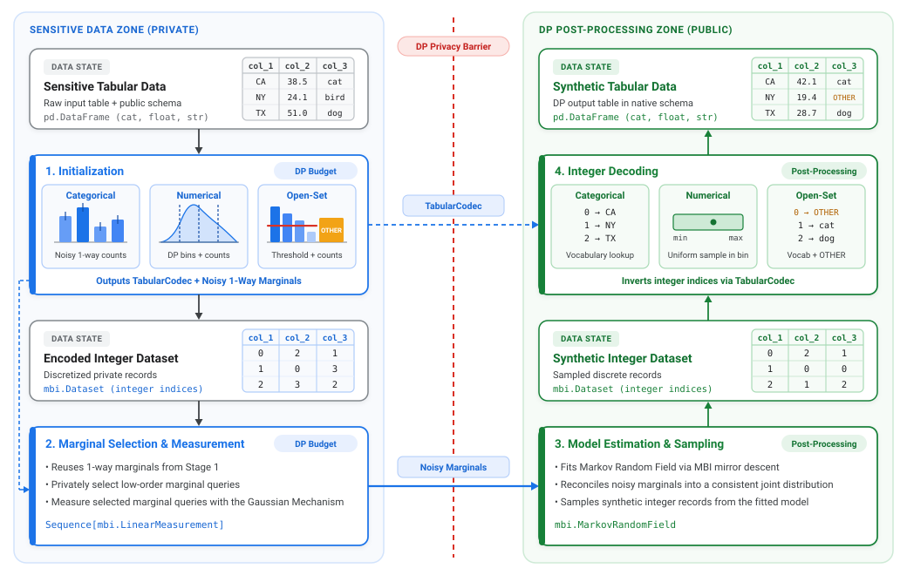

<!-- Copyright 2026 Google LLC

Licensed under the Apache License, Version 2.0 (the "License");
you may not use this file except in compliance with the License.
You may obtain a copy of the License at

    http://www.apache.org/licenses/LICENSE-2.0

Unless required by applicable law or agreed to in writing, software
distributed under the License is distributed on an "AS IS" BASIS,
WITHOUT WARRANTIES OR CONDITIONS OF ANY KIND, either express or implied.
See the License for the specific language governing permissions and
limitations under the License. -->

# Tabular Processing Lifecycle

<!-- disableFinding(LINK_RELATIVE_G3DOC) -->

Generating differentially private synthetic data for heterogeneous tabular
schemas requires estimating a joint distribution over mixed numerical,
closed-set categorical, and open-set string attributes. Representing the full
contingency table over $d$ attributes with domain sizes $k_1, \dots, k_d$
requires $\prod_i k_i$ entries (for example, $10^{20}$ cells for a
20-column dataset with 10 categories per column), which is both computationally
intractable to store and statistically impossible to measure accurately under
differential privacy. Furthermore, continuous numerical attributes and unbounded
string attributes have infinite support and cannot be represented directly in a
discrete graphical model.

DPSynth overcomes these bottlenecks by decomposing tabular synthesis into a
four-stage pipeline shared across the [In-Memory](index.md#quickstart) and
[Scalable Beam](scalable_beam_api.md)
APIs. This pipeline reduces mixed-type tabular records to a finite discrete
domain, measures low-order noisy marginals, estimates an undirected graphical
model via MBI ([McKenna et al., 2019](https://arxiv.org/abs/1901.09136)),
and decodes synthetic discrete samples back into the original schema.



## Graphical Models and Discretization

DPSynth models the joint distribution of a tabular dataset as a Markov Random
Field (MRF), an undirected probabilistic graphical model that factorizes the
joint probability mass function into a product of low-order clique potentials.
Rather than materializing the full $\prod_i k_i$ contingency table, the
model maintains parameters only over a collection of low-dimensional marginals
(typically pairwise or three-way attribute subsets), allowing inference and
sampling to scale to high-dimensional schemas whenever the underlying clique
graph has bounded treewidth.

```{important}
**Markov Random Fields are defined strictly over finite, discrete spaces.**

Each variable $i$ in the graphical model must take values in a finite integer
set $\{0, 1, \dots, k_i - 1\}$. Continuous numerical ranges and unbounded
open-set strings cannot be represented directly as discrete nodes in a graphical
model. Consequently, every raw attribute must be mapped to a finite vocabulary of
integer indices before marginal measurement and graphical model estimation can
proceed.
```

## Stage 1: Initialization

In Stage 1, DPSynth allocates an initialization fraction of the privacy budget
(controlled by `init_budget_fraction`, defaulting to $0.1$) across the columns
to run a calibrated per-column initializer on each attribute. Every initializer
returns a `ColumnMeasurement` containing **both** a finalized discrete domain
(`CategoricalAttribute`, which defines the column's encoding and decoding codec)
**and** the column's noisy one-way marginal counts (`noisy_counts` and noise
standard deviation $\sigma$, wrapped as an `mbi.LinearMeasurement`).

| Attribute Type | Initialization Mechanism | Returned `ColumnMeasurement` |
| :--- | :--- | :--- |
| `CategoricalAttribute` | Gaussian mechanism on one-way counts | Fixed vocabulary and noisy one-way marginal |
| `NumericalAttribute` | Recursive DP quantile bisection ([Kaplan et al., 2022](https://arxiv.org/abs/2110.05429)) + Gaussian counts | Discretization `bin_edges` and noisy one-way marginal |
| `OpenSetCategoricalAttribute` | Gaussian partition selection + one-way counts | Thresholded vocabulary and noisy one-way marginal |

For numerical attributes without pre-specified `bin_edges`, DPSynth partitions
the declared range $[\text{min\_value}, \text{max\_value}]$ into approximately
equal-frequency intervals (32 bins by default) using a hierarchical tree of
exponential mechanisms, concentrating bin resolution where data density is high.
For open-set string attributes, DPSynth adds Gaussian noise to observed category
counts and retains only categories that exceed a private selection threshold,
routing all remaining rare strings to a designated out-of-domain bin.

Once per-column initialization completes, each attribute $i$ has a fixed,
concrete domain of size $k_i$ encapsulated in a `TabularCodec`. The encoding
layer then maps every raw record deterministically into a dense vector of
zero-indexed integers in $\{0, 1, \dots, k_i - 1\}$, producing an encoded
`mbi.Dataset`. Because this row-wise encoding step applies the codecs fixed
during initialization without computing new data-dependent statistics, it
consumes zero additional privacy budget.

## Stage 2: Marginal Selection and Measurement

With the dataset encoded over $\{0, \dots, k_i - 1\}$, the remaining privacy
budget is passed to a discrete synthesis mechanism. The noisy one-way marginals
from Stage 1 are supplied as `initial_measurements` so the discrete mechanism
does not re-measure them and can dedicate its budget to privately selecting
low-order marginal queries and measuring them with the Gaussian mechanism:

*   **MST ([McKenna et al., 2021](https://arxiv.org/abs/2108.04978))**: Uses the
    exponential mechanism (or permute-and-flip) to privately select a maximum
    spanning tree of pairwise attribute correlations, and measures the selected
    two-way marginals with Gaussian noise.
*   **AIM ([McKenna et al., 2022](https://arxiv.org/abs/2201.12677))**:
    Iteratively selects and measures workload-informed marginals in an adaptive
    loop, balancing expected error reduction against marginal size and remaining
    privacy budget.
*   **SWIFT**: Selects a bounded-treewidth factor graph over high-utility
    cliques to capture denser multi-attribute dependencies.
*   **Direct / Independent**: Measures a prespecified workload of marginals (or
    relies on the one-way marginals alone) in a single non-adaptive batch.

## Stage 3: Model Estimation and Sampling

All noisy marginal measurements (`mbi.LinearMeasurement`), combining the one-way
measurements from Stage 1 with the higher-order clique marginals measured in
Stage 2, cross the differential privacy barrier into the MBI solver (`mbi`).
Sensitive data is never accessed again beyond this point.

Using mirror descent over the marginal polytope, MBI estimates the parameters
of an `mbi.MarkovRandomField` whose induced marginals best match the noisy
measurements in $L_2$ loss while guaranteeing a valid, non-negative, and
globally consistent joint distribution. Synthetic discrete records over
$\{0, \dots, k_i - 1\}$ are then sampled from the fitted graphical model,
producing a synthetic `mbi.Dataset`.

## Stage 4: Integer Decoding

Finally, the `TabularCodec` constructed in Stage 1 inverts the synthetic integer
indices back into their native column representations as pure post-processing:

*   **Categorical attributes**: Integer indices map back to their original
    domain values via vocabulary lookup.
*   **Numerical attributes**: Each bin index is mapped back to a number in
    $[\text{min\_value}, \text{max\_value}]$ by sampling uniformly within the
    bin interval (or taking the interval midpoint).
*   **Open-set attributes**: Discovered vocabulary indices map back to their
    corresponding strings, while index $0$ maps to the configured out-of-domain
    placeholder (such as `<OTHER>`).
